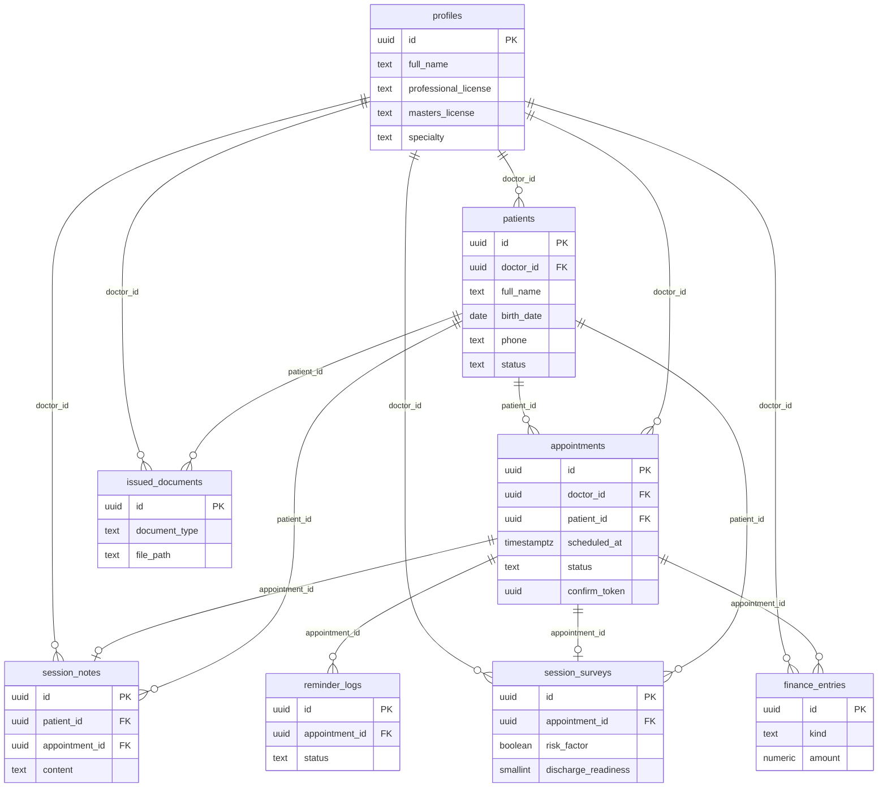

# Consultorio Marina Velázquez Tristán

**Sistema de gestión clínica para consultorio de psicología**  
Aplicación web completa orientada a objetos, con base de datos relacional real (PostgreSQL vía Supabase), autenticación, generación de PDFs, notificaciones y patrones de diseño aplicados.

| | |
|---|---|
| **Stack** | Next.js 14 · TypeScript · Supabase (PostgreSQL) · Vercel · Resend · pdf-lib · Tailwind CSS · Framer Motion |
| **URL de demostración** | https://consultorio-marina-c1b52giig-goti-team.vercel.app/ |
| **Autoría académica** | Proyecto de Programación Orientada a Objetos — entrega completa |

---

## Índice de entrega (requisitos del proyecto)

| # | Requisito | Ubicación en este documento |
|---|-----------|-----------------------------|
| 1 | Diagrama de Clases del Proyecto | [§4.1](#41-diagrama-de-clases-del-proyecto) + `diagrams/class-diagram.puml` |
| 2 | Diagrama de Bases de Datos (relación entre tablas) | [§4.2](#42-diagrama-de-bases-de-datos--relación-entre-tablas) + `diagrams/database-diagram.puml` |
| 3 | 4 pilares de la POO (Herencia, Encapsulación, Abstracción, Polimorfismo) | [§3](#3-los-4-pilares-de-la-poo-aplicados) |
| 4 | Conexión a Base de Datos: CRUD / ABCD | [§5](#5-conexión-a-base-de-datos--crud--abcd) |
| 5 | Entrega de Código | [§8](#8-entrega-de-código--estructura-del-repositorio) (todo el repositorio) |
| 6 | Entrega de la estructura de la DB | [§6](#6-estructura-completa-de-la-base-de-datos) + `db/schema.sql` + `db/seed.sql` |
| 7 | README profesional: objetivo, diagramas, instalación y corrida | Este documento completo |

---

## 1. Objetivo del proyecto

Construir un **sistema real de administración de consultorio psicológico** que unifique:

- Agenda clínica con horario de negocio (08:00–20:00, franjas de 50 min).
- Expediente del paciente (datos personales, contacto de emergencia, medicación, notas de sesión).
- Ciclo de vida de la cita: agendar → recordatorio con token → confirmación → atención → completar → encuesta post-sesión (con detección de factor de riesgo).
- Emisión de documentos oficiales (justificante, constancia, permiso escolar) en PDF con membrete y cédulas reales.
- Control financiero simple (ingresos / gastos) y estadísticas mensuales.

Todo ello **persistido en una base de datos relacional real**, con autenticación, Row Level Security, patrones de diseño y los cuatro pilares de la Programación Orientada a Objetos explícitamente aplicados y documentados.

No se trata de un prototipo en memoria: cada alta, consulta, actualización o baja escribe y lee de PostgreSQL (Supabase).

---

## 2. Arquitectura general

```
┌─────────────────────────────────────────────────────────────────┐
│                        CLIENTE (Browser)                        │
│  Next.js App Router · React · Tailwind · Framer Motion          │
└───────────────────────────────┬─────────────────────────────────┘
                                │ HTTPS
┌───────────────────────────────▼─────────────────────────────────┐
│                     CAPA DE PRESENTACIÓN                        │
│  app/ (páginas) · components/ · API Routes (app/api/*)          │
└───────────────────────────────┬─────────────────────────────────┘
                                │
┌───────────────────────────────▼─────────────────────────────────┐
│                    CAPA DE APLICACIÓN / DOMINIO                 │
│  Repositories · Services · Patterns (Strategy, Observer)        │
│  Factory Method (PDF) · StatisticsService                       │
└───────────────────────────────┬─────────────────────────────────┘
                                │
┌───────────────────────────────▼─────────────────────────────────┐
│                     CAPA DE PERSISTENCIA                        │
│  Supabase Client (Singleton) · Row Level Security               │
│  PostgreSQL (profiles, patients, appointments, …)               │
└─────────────────────────────────────────────────────────────────┘
```

---

## 3. Los 4 pilares de la POO aplicados

### 3.1 Abstracción

Se modelan las entidades del dominio como tipos e interfaces que ocultan la complejidad de la base de datos y de las APIs externas.

**Ejemplo — modelo de dominio** (`src/types/index.ts`):

```ts
export interface Patient {
  id: string;
  doctor_id: string;
  full_name: string;
  birth_date: string | null;
  // ... resto de campos
  status: PatientStatus;
}

export interface IPatientRepository {
  findAll(): Promise<Patient[]>;
  findById(id: string): Promise<Patient | null>;
  create(data: Omit<Patient, "id" | "doctor_id" | "created_at" | "updated_at">): Promise<Patient>;
  update(id: string, data: Partial<Patient>): Promise<Patient>;
}
```

La aplicación trabaja con `Patient` y `IPatientRepository`; no necesita conocer SQL ni el esquema de Supabase.

**Ejemplo — abstracción de canal de notificación** (`src/lib/patterns/NotificationStrategy.ts`):

```ts
export interface NotificationChannel {
  send(to: string, subject: string, body: string): Promise<void>;
}
```

### 3.2 Encapsulación

Los detalles de implementación se ocultan detrás de interfaces y clases; el estado interno no se expone directamente.

- **Singleton de conexión** (`src/lib/supabase/server.ts`): el cliente con *Service Role* se crea una sola vez y se guarda en una variable de módulo privada (`adminClient`). Ningún consumidor puede instanciarlo de otra forma.
- **Repositorio**: la clase `SupabasePatientRepository` encapsula todas las llamadas a `supabase.from("patients")…`. El resto del código solo llama a `findAll()`, `create()`, etc.
- **Factory de documentos**: `DocumentTemplateFactory.create(type)` encapsula la decisión de qué plantilla concreta usar; el llamador no conoce las clases `JustificanteTemplate`, `ConstanciaTemplate` ni `PermisoEscolarTemplate`.

### 3.3 Herencia

Las plantillas de PDF heredan de una clase base abstracta (o de un contrato común) y reutilizan el membrete, tipografía y pie de página.

**Ejemplo en** `src/lib/pdf/DocumentTemplateFactory.ts`:

```ts
// Contrato común (abstracción + base para herencia de comportamiento)
abstract class DocumentTemplate {
  abstract render(data: DocumentRequest & { patient: Patient }): Promise<Uint8Array>;
  // Métodos compartidos: dibujar membrete, cédulas, pie de página…
}

class JustificanteTemplate extends DocumentTemplate { /* … */ }
class ConstanciaTemplate extends DocumentTemplate { /* … */ }
class PermisoEscolarTemplate extends DocumentTemplate { /* … */ }
```

Todas las plantillas comparten la lógica de cabecera (nombre de la psicóloga, cédulas profesionales, ciudad) y solo implementan el cuerpo específico del documento.

### 3.4 Polimorfismo

El mismo mensaje produce comportamientos distintos según el tipo concreto.

| Lugar | Cómo se usa el polimorfismo |
|-------|-----------------------------|
| **Factory Method** | `DocumentTemplateFactory.create("justificante")` devuelve un objeto que responde a `render()`; el llamador no distingue la clase concreta. |
| **Strategy** | `NotificationService` recibe cualquier `NotificationChannel` (`EmailChannel` hoy; mañana `WhatsAppChannel`). Llama siempre a `channel.send(…)`. |
| **Observer** | `SurveyService` notifica a una lista de `SurveyObserver`. `RiskAlertObserver` y un posible `StatisticsObserver` reaccionan de forma distinta al mismo evento `onSurveySubmitted`. |
| **Repository** | Cualquier implementación de `IPatientRepository` (hoy Supabase, mañana otra) se puede inyectar sin cambiar las páginas ni las API routes. |

**Fragmento real — Strategy**:

```ts
// NotificationService usa la interfaz, no la clase concreta
class NotificationService {
  constructor(private channel: NotificationChannel) {}
  async notify(to: string, subject: string, body: string) {
    await this.channel.send(to, subject, body); // polimórfico
  }
}
```

**Fragmento real — Observer**:

```ts
interface SurveyObserver {
  onSurveySubmitted(survey: SessionSurvey): Promise<void>;
}

class RiskAlertObserver implements SurveyObserver {
  async onSurveySubmitted(survey: SessionSurvey) {
    if (survey.risk_factor) { /* alerta a la psicóloga / contacto */ }
  }
}
```

---

## 4. Diagramas UML

Los diagramas fuente están en formato **PlantUML** (`.puml`) dentro de la carpeta `diagrams/`. Se pueden renderizar en [plantuml.com](https://www.plantuml.com/plantuml), en VS Code (extensión PlantUML) o en cualquier CI.

### 4.1 Diagrama de Clases del Proyecto

Archivo: [`diagrams/class-diagram.puml`](diagrams/class-diagram.puml)

**Vista resumida (entidades de dominio + relaciones principales):**

```
                    ┌──────────────┐
                    │   Entity     │  (abstract)
                    │ +id: UUID    │
                    │ +createdAt   │
                    └──────┬───────┘
           ┌───────────────┼───────────────┐
           │               │               │
    ┌──────▼──────┐ ┌──────▼──────┐ ┌──────▼──────────┐
    │   Doctor    │ │   Patient   │ │  Appointment    │
    │ fullName    │ │ fullName    │ │ scheduledAt     │
    │ licenses…   │ │ phone       │ │ status          │
    │ specialty   │ │ emergency…  │ │ confirmToken    │
    └─────────────┘ │ status      │ │ confirm()       │
                    │ age()       │ │ cancel()        │
                    └──────┬──────┘ │ markCompleted() │
                           │        └────────┬────────┘
                           │ 1            *  │
                           └────────┬────────┘
                                    │
              ┌─────────────────────┼─────────────────────┐
              │                     │                     │
       ┌──────▼──────┐      ┌───────▼───────┐     ┌───────▼────────┐
       │ SessionNote │      │ SessionSurvey │     │ IssuedDocument │
       │ content     │      │ risk_factor   │     │ documentType   │
       └─────────────┘      │ flagRisk()    │     │ generate()     │
                            └───────────────┘     └────────────────┘
```

También aparecen en el diagrama completo:

- Servicios de aplicación: `AppointmentScheduler`, `SurveyService`, `DocumentGenerator`, `NotificationService`, `StatisticsService`.
- Enumeraciones: `PatientStatus`, `AppointmentStatus`, `FinanceKind`, `DocumentType`.

### 4.2 Diagrama de Bases de Datos — relación entre tablas

Archivo: [`diagrams/database-diagram.puml`](diagrams/database-diagram.puml)

**Modelo entidad-relación (Mermaid):**



### 4.3 Diagrama de patrones de diseño

Archivo: [`diagrams/patterns-diagram.puml`](diagrams/patterns-diagram.puml)

Documenta los cinco patrones aplicados:

1. **Singleton** — cliente Supabase (browser y admin).
2. **Repository** — `IPatientRepository` / `SupabasePatientRepository` (y análogo para citas).
3. **Factory Method** — `DocumentTemplateFactory` + plantillas de PDF.
4. **Strategy** — `NotificationChannel` + `EmailChannel` / futuro `WhatsAppChannel`.
5. **Observer** — `SurveyObserver` + `RiskAlertObserver`.

Detalle narrativo de cada patrón: [`docs/patrones-de-diseno.md`](docs/patrones-de-diseno.md).

---

## 5. Conexión a Base de Datos — CRUD / ABCD

La conexión se realiza mediante el cliente oficial de Supabase (`@supabase/ssr` + `@supabase/supabase-js`).

| Operación | Nombre clásico | Ejemplo real en el proyecto |
|-----------|----------------|-----------------------------|
| **C**reate | Alta | `SupabasePatientRepository.create(…)` → `INSERT` en `patients` |
| **R**ead   | Consulta | `findAll()`, `findById(id)` → `SELECT` |
| **U**pdate | Modificación | `update(id, data)` → `UPDATE` |
| **D**elete | Baja lógica / física | Cambio de `status` a `de_alta` / `pausado`; o `DELETE` en cascada al borrar paciente |

**Flujo de conexión (resumen):**

1. Variables de entorno (`.env.local` / Vercel):
   - `NEXT_PUBLIC_SUPABASE_URL`
   - `NEXT_PUBLIC_SUPABASE_ANON_KEY`
   - `SUPABASE_SERVICE_ROLE_KEY` (solo servidor)
2. Cliente de sesión (RLS activo): `getSupabaseServerClient()` / `getSupabaseBrowserClient()`.
3. Cliente admin (Service Role, Singleton): `getSupabaseAdminClient()` — usado exclusivamente por rutas públicas (confirmación por token, encuesta, cron).
4. Los repositorios reciben el cliente por inyección y ejecutan las operaciones CRUD.

**Ejemplo de Create + Read** (`src/lib/repositories/PatientRepository.ts`):

```ts
async create(data: …): Promise<Patient> {
  const { data: row, error } = await this.db
    .from("patients")
    .insert(data)
    .select()
    .single();
  if (error) throw error;
  return row as Patient;
}

async findAll(): Promise<Patient[]> {
  const { data, error } = await this.db
    .from("patients")
    .select("*")
    .order("full_name", { ascending: true });
  if (error) throw error;
  return data as Patient[];
}
```

Las mismas operaciones existen para citas, notas de sesión, entradas financieras y documentos emitidos a través de las rutas API (`src/app/api/**`).

---

## 6. Estructura completa de la Base de Datos

Motor: **PostgreSQL 15+** (Supabase).  
Archivo de creación: [`db/schema.sql`](db/schema.sql)  
Datos de prueba: [`db/seed.sql`](db/seed.sql)

### 6.1 Tablas

| Tabla | Propósito | Clave primaria | FK principales |
|-------|-----------|----------------|----------------|
| `profiles` | Perfil de la psicóloga (extiende `auth.users`) | `id` → `auth.users` | — |
| `patients` | Expediente del paciente | `id` | `doctor_id` → `auth.users` |
| `appointments` | Citas agendadas | `id` | `doctor_id`, `patient_id` |
| `session_notes` | Notas clínicas de sesión | `id` | `patient_id`, `appointment_id`, `doctor_id` |
| `session_surveys` | Encuesta post-sesión + factor de riesgo | `id` | `appointment_id`, `patient_id`, `doctor_id` |
| `finance_entries` | Ingresos y gastos | `id` | `doctor_id`, `appointment_id` (opcional) |
| `issued_documents` | Registro de PDFs generados | `id` | `doctor_id`, `patient_id` |
| `reminder_logs` | Log de recordatorios enviados | `id` | `appointment_id` |

### 6.2 Columnas relevantes y restricciones

**patients**

| Columna | Tipo | Notas |
|---------|------|-------|
| id | uuid | PK, `gen_random_uuid()` |
| doctor_id | uuid | FK, default `auth.uid()` |
| full_name | text | NOT NULL |
| phone | text | NOT NULL |
| emergency_contact_name / phone | text | NOT NULL |
| status | text | `activo` \| `de_alta` \| `pausado` |
| created_at / updated_at | timestamptz | |

**appointments**

| Columna | Tipo | Notas |
|---------|------|-------|
| scheduled_at | timestamptz | NOT NULL |
| duration_minutes | int | default 50 |
| status | text | `agendada`, `confirmada`, `cancelada`, `completada`, `no_asistio` |
| confirm_token | uuid | único, para enlace público |
| price | numeric(10,2) | |
| chk_business_hours | CHECK | hora entre 8 y 20 (America/Mexico_City) |

**session_surveys**

| Columna | Tipo | Notas |
|---------|------|-------|
| discharge_readiness | smallint | 1–10 |
| risk_factor | boolean | dispara Observer de alerta |
| emergency_contact_notified | boolean | |

Todas las tablas de negocio tienen **Row Level Security** activado: cada psicóloga solo ve y modifica sus propios registros (`auth.uid() = doctor_id`).

### 6.3 Cómo aplicar el esquema

1. Crear proyecto en [supabase.com](https://supabase.com).
2. SQL Editor → New query → pegar y ejecutar **todo** el contenido de `db/schema.sql`.
3. (Opcional) Ejecutar `db/seed.sql` sustituyendo `<TU_USER_ID>` por el UUID del usuario creado en Authentication → Users.

---

## 7. Instalación y puesta en marcha

Guía detallada paso a paso: [`docs/instrucciones_ejecucion.txt`](docs/instrucciones_ejecucion.txt).

### Resumen rápido (desarrollo local)

```bash
# 1. Clonar / descomprimir el repositorio
cd consultorio-marina

# 2. Instalar dependencias
npm install

# 3. Configurar variables de entorno
cp .env.example .env.local
# Editar .env.local con:
#   NEXT_PUBLIC_SUPABASE_URL=
#   NEXT_PUBLIC_SUPABASE_ANON_KEY=
#   SUPABASE_SERVICE_ROLE_KEY=
#   RESEND_API_KEY=
#   CRON_SECRET=          (opcional, para proteger el cron)

# 4. Ejecutar el esquema en Supabase (SQL Editor) → db/schema.sql

# 5. Arrancar
npm run dev
# Abrir http://localhost:3000
```

### Despliegue en Vercel

1. Subir el repositorio a GitHub.
2. Importar en Vercel → Framework: Next.js.
3. Configurar las mismas variables de entorno.
4. (Opcional) El cron de recordatorios ya está declarado en `vercel.json` (`/api/cron/reminders` a las 14:00 UTC).

### Captura de corrida / verificación

Una vez levantado el sistema se puede comprobar:

1. Login con el usuario de Supabase Auth.
2. Alta de paciente → aparece en listado y en la base de datos.
3. Agenda de cita en horario válido → fila en `appointments`.
4. Completar cita → envío de enlace de encuesta.
5. Respuesta de encuesta con factor de riesgo → registro en `session_surveys` y lógica de alerta.
6. Generación de PDF (justificante / constancia / permiso) → descarga del documento y fila en `issued_documents`.
7. Vista de estadísticas e ingresos/gastos.

(La URL de demostración pública permite inspeccionar la interfaz desplegada.)

---

## 8. Entrega de código — estructura del repositorio

```
consultorio-marina/
├── db/
│   ├── schema.sql                 # Estructura completa de la BD (requisito 6)
│   └── seed.sql                   # Datos de ejemplo
├── diagrams/
│   ├── class-diagram.puml         # Diagrama de clases (requisito 1)
│   ├── database-diagram.puml      # Diagrama ER (requisito 2)
│   └── patterns-diagram.puml      # Patrones de diseño
├── docs/
│   ├── instrucciones_ejecucion.txt
│   ├── patrones-de-diseno.md
│   └── refactorizacion.md
├── src/
│   ├── app/                       # App Router (páginas + API routes)
│   │   ├── api/                   # CRUD de pacientes, citas, finanzas, PDF, cron…
│   │   ├── dashboard/             # Área autenticada
│   │   ├── confirmar/[token]/    # Confirmación pública de cita
│   │   ├── encuesta/[appointmentId]/
│   │   ├── layout.tsx
│   │   └── page.tsx
│   ├── components/                # UI reutilizable
│   ├── lib/
│   │   ├── supabase/              # Singleton de conexión
│   │   ├── repositories/          # Capa Repository (CRUD)
│   │   ├── patterns/              # Strategy + Observer
│   │   ├── pdf/                   # Factory Method de documentos
│   │   ├── services/
│   │   └── utils/
│   ├── types/                     # Modelo de dominio (interfaces)
│   └── middleware.ts              # Protección de rutas
├── .env.example
├── next.config.js
├── package.json
├── tailwind.config.ts
├── tsconfig.json
├── vercel.json                    # Cron de recordatorios
└── README.md                      # Este documento (requisito 7)
```

Todo el código fuente de producción se entrega en este repositorio. No hay datos simulados en las rutas de negocio: cada operación interactúa con PostgreSQL.

---

## 9. Funcionalidad de punta a punta (recorrido de demostración)

1. La psicóloga inicia sesión (Supabase Auth).
2. Registra o selecciona un paciente (CRUD real).
3. Agenda una cita en un horario libre (08:00–20:00); la restricción está en UI y en constraint de BD.
4. El cron diario (`/api/cron/reminders`) envía correo con enlace de confirmación (`confirm_token`).
5. El paciente confirma sin necesidad de cuenta (`/confirmar/[token]`).
6. Tras la sesión, se marca la cita como completada → se dispara la encuesta.
7. Si la encuesta marca factor de riesgo, el Observer de alerta actúa.
8. En cualquier momento se pueden emitir PDFs oficiales y consultar estadísticas financieras.

---

## 10. Referencias internas de la entrega

| Requisito | Artefacto principal |
|-----------|---------------------|
| 1. Diagrama de clases | `diagrams/class-diagram.puml` + §4.1 |
| 2. Diagrama de BD | `diagrams/database-diagram.puml` + §4.2 |
| 3. 4 pilares POO | §3 (con fragmentos de código real) |
| 4. Conexión + CRUD | §5 + `src/lib/repositories/*` + `src/app/api/*` |
| 5. Código fuente | Todo el árbol `src/` y configuración |
| 6. Estructura DB | `db/schema.sql` + §6 |
| 7. README + instalación + objetivo | Este archivo + `docs/instrucciones_ejecucion.txt` |

---

**Consultorio Marina Velázquez Tristán** — Sistema académico y de uso real para la gestión de un consultorio de psicología, construido bajo los principios de la Programación Orientada a Objetos.
